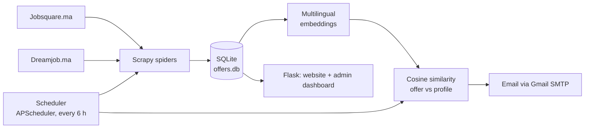
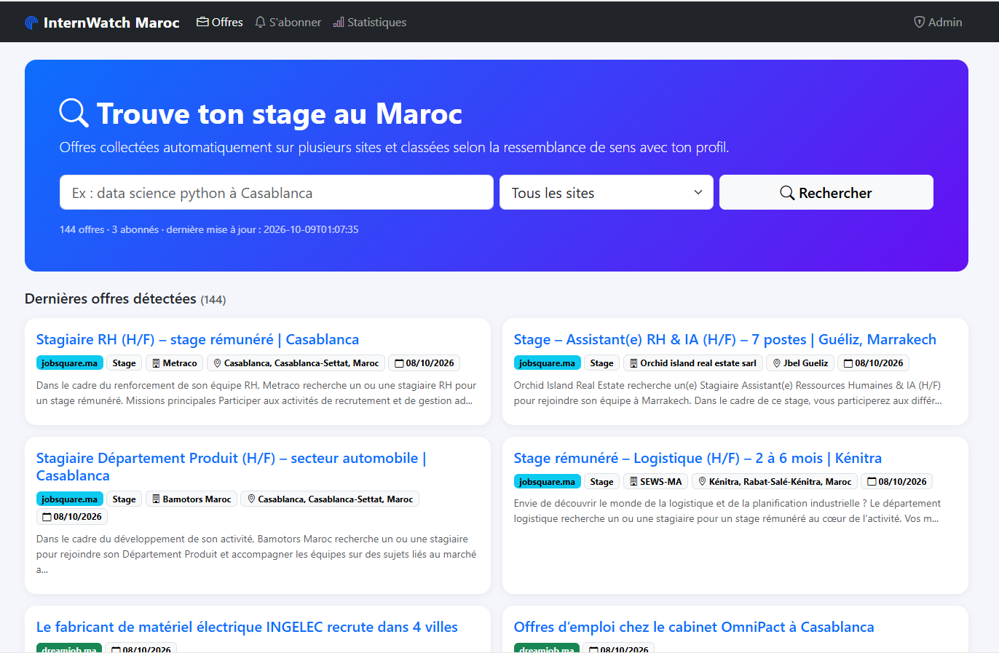
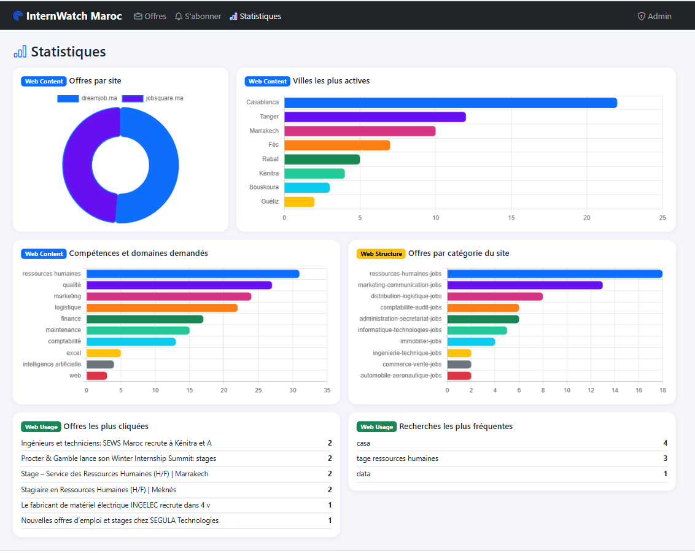
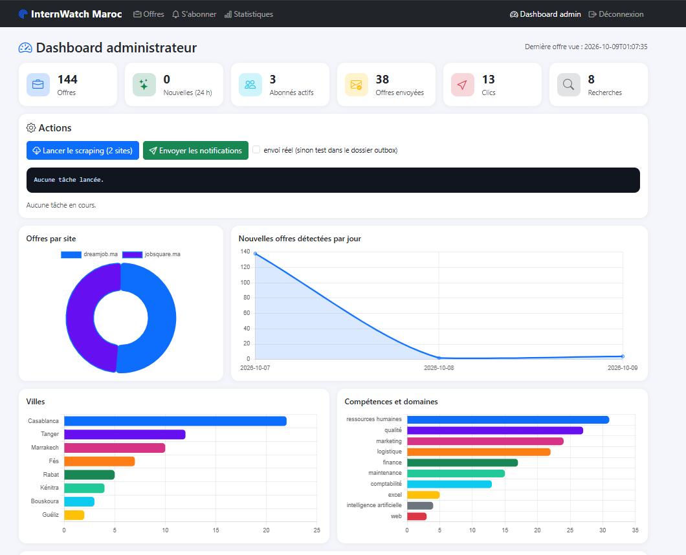

<div align="center">

# 📡 InternWatch Maroc

**Automated monitoring of internship offers in Morocco: scraping, new-offer detection, AI matching and email alerts.**


*University project: Web Analytics & Language Representation Learning*

</div>

---

## 🎯 Overview

InternWatch Maroc is a web application that:

1. **periodically scrapes** several Moroccan internship websites;
2. **detects newly published offers** (an offer is never processed twice);
3. **compares the meaning** of each offer with each subscriber's profile using multilingual *embeddings*;
4. **automatically emails** the relevant offers, without duplicates.

A website lets visitors search offers and subscribe, and an admin dashboard lets you control the whole system.

> The user interface is in French, since the target audience is Moroccan students.

## ✨ Features

| User side | Admin side |
|---|---|
| 🔎 **Semantic search** ("data science python" also finds "artificial intelligence" offers) | 📊 KPIs: offers, new in the last 24 h, subscribers, emails sent, clicks, searches |
| 🏷️ Filter by source site, pagination, similarity score | ▶️ Run scraping and notifications with one click, with a live log |
| 🔔 Subscription with a profile and a selectivity level | 👥 Subscriber management (enable, disable, delete) |
| 📈 Statistics: cities, skills, site categories | 📬 History of sent notifications |
| ✉️ Unsubscribe form | 🔒 Password-protected access |

## 🧠 Link with the course

| Course concept | In this project |
|---|---|
| **Web Content** | Title, company, city, contract type, description and full text of offers; statistics by city and skill |
| **Web Structure** | Automatic discovery of the site's categories, pagination, originating category of each offer, number of links per offer |
| **Web Usage** | Visitors' clicks on offers and searches are recorded, then displayed in the statistics |
| **Web Scraping** | Two **Scrapy** spiders (`jobsquare`, `dreamjob`) |
| **Language Representation Learning** | `paraphrase-multilingual-MiniLM-L12-v2` model: offers and profiles become vectors compared with cosine similarity |

## 🏗️ Architecture



**How new offers are detected**: every offer has a unique key `source + offer_id`. On each scrape, an unknown offer is inserted ("new"), while a known offer only gets its last-seen date updated.

**How duplicate emails are avoided**: a `notifications` table remembers which offer has already been sent to which subscriber. An email is sent only if it contains at least one offer that was never received and that is above the subscriber's threshold.

## 📁 Project structure

```
internwatch/
├── app.py                  # Flask website + admin dashboard (Bootstrap, Chart.js)
├── scheduler.py            # Scheduler: periodic scraping + notifications
├── notifier.py             # Subscribers, matching, email sending
├── matching.py             # Embeddings and similarity search
├── dbutil.py               # Robust SQLite connection + lock preventing overlapping tasks
├── scrapy.cfg
├── internship_scraper/
│   ├── settings.py         # Politeness: robots.txt, delay, user-agent
│   ├── pipelines.py        # SQLite insertion + new-offer detection
│   └── spiders/
│       ├── jobsquare_spider.py
│       └── dreamjob_spider.py
├── env.exemple.ps1         # Template for environment variables
├── requirements.txt
└── README.md
```

## 🚀 Installation

**Requirements**: Python 3.11, Git, and a Gmail account with an [app password](https://myaccount.google.com/apppasswords) to send real emails.

```powershell
# 1. Clone the repository
git clone https://github.com/<your-username>/internwatch-maroc.git
cd internwatch-maroc

# 2. Create and activate the virtual environment
py -3.11 -m venv venv
venv\Scripts\activate

# 3. Install the dependencies
pip install -r requirements.txt
```

> The first run downloads the embedding model (about 470 MB).

## ⚙️ Configuration

Copy `env.exemple.ps1` to `env.ps1`, then fill in your own values:

```powershell
$env:ADMIN_PASSWORD="choose-an-admin-password"
$env:GMAIL_USER="your.address@gmail.com"
$env:GMAIL_APP_PASSWORD="google-app-password"
```

Load them into the terminal before each launch:

```powershell
. .\env.ps1
```

> ⚠️ `env.ps1` contains secrets: it is excluded from Git by `.gitignore`. Never publish it.

## ▶️ Usage

**1. Fill the database for the first time**

```powershell
scrapy crawl jobsquare -s LOG_LEVEL=INFO
scrapy crawl dreamjob -s LOG_LEVEL=INFO
```

The log prints `BILAN BASE [...] : X NOUVELLES offres, Y deja connues` (X new offers, Y already known).

**2. Start the website** (terminal 1)

```powershell
python app.py
```

Open <http://127.0.0.1:5000>. The dashboard is at `/admin`.

**3. Start the scheduler** (terminal 2)

```powershell
python scheduler.py --hours 6 --send        # real emails
python scheduler.py --hours 6               # test mode: emails written to outbox/
python scheduler.py --minutes 10 --now      # demo: immediate cycle, then every 10 min
```

**Useful commands**

```powershell
python notifier.py add email@example.com "data science python" 0.30   # add a subscriber
python notifier.py list                                                 # list subscribers
python notifier.py run --send                                           # send now
```

The threshold (`0.30`) sets the selectivity: the higher it is, the closer to the profile the emailed offers must be.

## 📸 Screenshots

| Home | Statistics | Admin dashboard |
|---|---|---|
|  |  |  |

## 🤝 Responsible scraping

- Each site's `robots.txt` is **respected** (`ROBOTSTXT_OBEY = True`).
- The crawler **identifies itself honestly** (`InternWatchBot`) instead of posing as a browser.
- Requests are **2 seconds apart**, with only one request at a time per site.
- Rekrute.com and Emploi.ma reject robots (HTTP 403): they were **left out** rather than bypassed.

## ⚠️ Known limitations

- Only two sources. Sites that block robots were not bypassed.
- Dreamjob publishes articles that often **group several positions**: each article counts as a single offer, without a separate city or company.
- Jobsquare: the description used is an excerpt from the listing page, not the full text.
- Very few data-science offers in the collected data: matching is therefore less striking there, whereas it is clear on better-represented fields (human resources, for example).
- The admin dashboard is protected by a simple password: fine for a university project, not for a public deployment.
- The application runs locally: the computer must stay on for the scheduler to work.

## 🔭 Possible improvements

- Add other robot-friendly sources, or official APIs.
- Fetch the full text of each Jobsquare offer.
- Split Dreamjob's multi-position articles into separate offers.
- Deploy on a server for 24/7 operation.
- Add an unsubscribe link directly in every email.

## 👤 Author

Project by **Fouad EL OUAFY -->GITHUB(https://github.com/FouadElOuafy)** for the course *Web Analytics & Language Representation Learning*.
